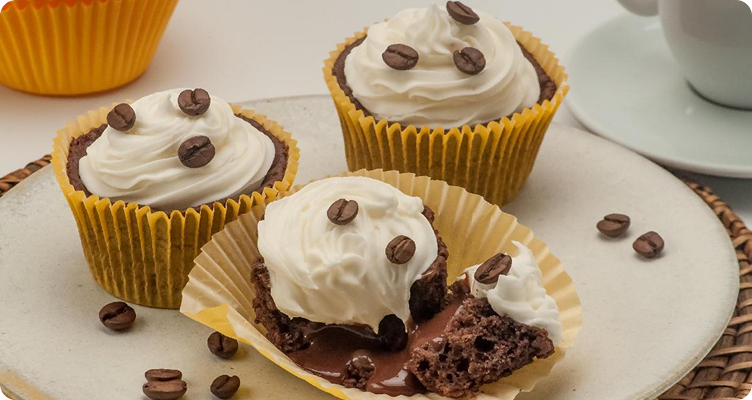

# 🧁 Página de Receita

Projeto desenvolvido com o auxílio da **Rocketseat** para aprimorar meus conhecimentos em desenvolvimento web e praticar os fundamentos de **HTML e CSS**.

A página apresenta uma receita de **cupcake de café com chantilly**, com imagem, informações gerais, lista de ingredientes e modo de preparo.

## 📸 Prévia



## 🛠️ Tecnologias utilizadas

- **HTML5** — estrutura e organização do conteúdo.
- **CSS3** — estilização, cores, espaçamentos e layout.
- **Google Fonts** — fonte Alice.

## 📚 Aprendizados

Durante o desenvolvimento, pratiquei:

- Estruturação de páginas com elementos semânticos, como `main`, `section` e `footer`.
- Organização de títulos, parágrafos e listas.
- Inclusão de imagens e textos alternativos.
- Uso de seletores CSS, box model, margens e preenchimentos.
- Personalização de tipografia, cores, imagem de fundo e bordas arredondadas.
- Organização dos arquivos de um projeto web.

## 🚀 Como visualizar

1. Baixe ou clone este repositório.
2. Abra o arquivo `index.html` no navegador.

Também é possível abrir a página pelo **Live Server** no VS Code. O projeto é estático e não precisa de instalação de dependências ou etapa de build. Para carregar a fonte do Google Fonts, é necessário acesso à internet.

## 📁 Estrutura do projeto

```text
projeto-receitas-fullstack/
├── index.html
├── README.md
└── assets/
    ├── style.css
    ├── main-image.jpg
    ├── bg.jpg
    └── heart.svg
```

## 💜 Créditos

Desenvolvido por mim como parte dos meus estudos, com auxílio dos conteúdos e orientações da **Rocketseat**.
