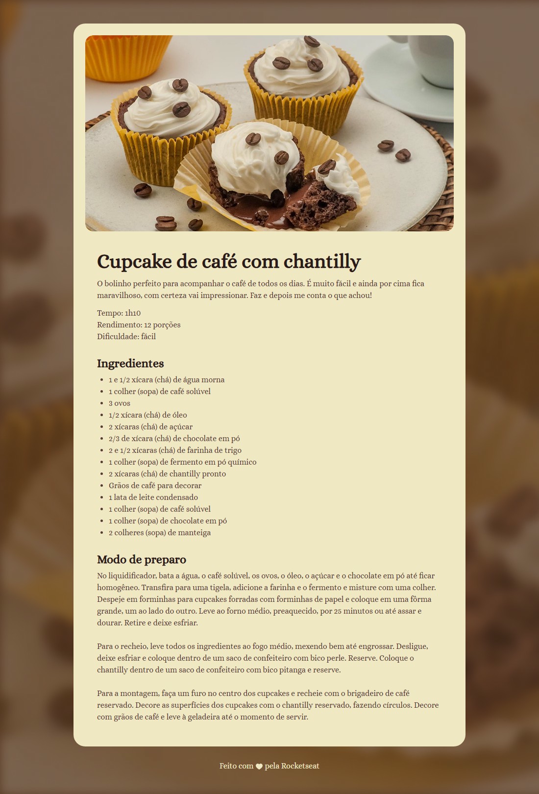

<h1 align="center">🧁 Página de Receita</h1>

<p align="center">
  Cupcake de café com chantilly — uma receita para praticar HTML e CSS.
</p>

<p align="center">
  
  
</p>

<p align="center">
  <a href="#sobre">Sobre</a> &nbsp;·&nbsp;
  <a href="#aprendizados">Aprendizados</a> &nbsp;·&nbsp;
  <a href="#como-executar">Como executar</a>
</p>

<p align="center">
  
</p>

## Sobre

Uma página de receita de **cupcake de café com chantilly**, com foto, tempo de preparo, rendimento, ingredientes e o passo a passo.

Desenvolvi este projeto durante meus estudos no curso Full Stack da **Rocketseat** para colocar em prática os fundamentos de HTML e CSS. O objetivo foi transformar o layout de referência em uma página organizada e fácil de ler.

O visual combina tons de café e creme, a fonte **Alice** e um cartão central com cantos arredondados, sobre uma imagem de fundo.

## Aprendizados

- Separar o conteúdo em seções com `main`, `section` e `footer`.
- Organizar a receita com títulos, parágrafos e uma lista de ingredientes.
- Inserir imagens e descrever seu conteúdo com o atributo `alt`.
- Entender a diferença entre margem e preenchimento ao ajustar os espaços da página.
- Usar seletores CSS para definir cores, tamanhos e estilos de texto.
- Carregar uma fonte do Google Fonts e aplicar uma imagem de fundo.

Aqui, o foco esteve nos detalhes básicos que constroem o layout: a largura do cartão, o espaço entre as seções, o recuo da lista e a altura das linhas para facilitar a leitura da receita.

## Tecnologias

**HTML · CSS · Google Fonts**

A fonte utilizada é a **Alice**, que dá à página um estilo parecido com o de um livro de receitas.

## Como executar

Clone o repositório:

```bash
git clone https://github.com/rafadsdev/Projeto-Receita.git
```

Depois, abra o arquivo `index.html` no navegador. Também é possível abrir a pasta no VS Code e utilizar a extensão **Live Server**.

Não é necessário instalar dependências.

## Organização

- `index.html` — conteúdo e estrutura da receita.
- `assets/style.css` — estilos, cores, tipografia e espaçamentos.
- `assets/main-image.jpg` — fotografia dos cupcakes.
- `assets/bg.jpg` — imagem de fundo da página.
- `assets/heart.svg` — ícone utilizado no rodapé.
- `assets/preview.svg` — captura da página para este README.

---

Desenvolvido por [Rafael](https://github.com/rafadsdev) durante o curso Full Stack da [Rocketseat](https://www.rocketseat.com.br/).

Layout e materiais utilizados como parte das aulas.
